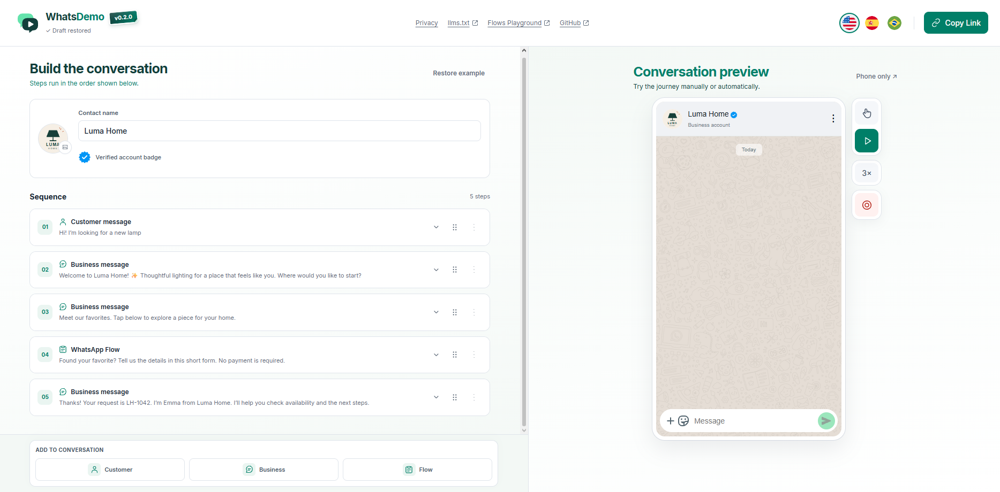

# WhatsDemo

<p align="center">
  
</p>

<p align="center"><strong>Build the conversation. Show the experience.</strong><br />Create interactive WhatsApp demos before building the real integration.</p>

<p align="center">
  <a href="https://github.com/guilher-me/whats-demo/actions/workflows/ci.yml"></a>
  <a href="LICENSE"></a>
  <a href="package.json"></a>
  <a href="docs/getting-started.md"></a>
  <a href="docs/user-guide.md#interface-languages"></a>
</p>

<p align="center">
  <a href="https://guilher-me.github.io/whats-demo/">Live demo</a> ·
  <a href="#see-it-in-action">See it in action</a> ·
  <a href="docs/getting-started.md">Install & run</a> ·
  <a href="docs/user-guide.md">User guide</a> ·
  <a href="docs/ai-guide.md">Build with an LLM</a> ·
  <a href="CONTRIBUTING.md">Contribute</a> ·
  <a href="LICENSE">License</a>
</p>

## Make the experience tangible before you build it

You have an idea for a WhatsApp customer journey. Explaining it with slides loses the interaction. Building a real integration just to demonstrate it takes engineering work. Previewing a form alone leaves out the conversation around it.

**WhatsDemo gives you a place to build and demonstrate the whole sequence:** customer messages, business replies, buttons, lists and WhatsApp Flows in a familiar phone preview. Configure the journey on the left, then let someone try it or play it automatically on the right.

Use it for sales demos, product reviews, workshops, usability discussions and training. No WhatsApp account setup, backend or database is required to run a demo.



## See it in action

Meet **Luma Home**, the fictional lighting store included with the app. A customer explores a collection, picks a lamp from a list, completes a two-screen Flow and receives a request confirmation.


The example uses fictional customer details. Replace its messages, business identity and forms with your own scenario.

## From an idea to a demo people can try

1. **Build the journey.** Add customer messages, business replies or Flows. Edit text, choices, delays and automatic answers.
2. **Try the conversation.** Send a message to start manual playback, or use automatic playback with an animated cursor.
3. **Share the experience.** Copy a link from a hosted installation, record a phone-only video, or hand a teammate the portable HTML app.

| What you need to show                           | What WhatsDemo provides                                                                                                |
| ----------------------------------------------- | ---------------------------------------------------------------------------------------------------------------------- |
| A conversation that feels like messaging        | Editable customer and business messages, typing indicators, delivery/read receipts and WhatsApp-style text formatting. |
| More than plain text                            | Reply buttons, sectioned lists and interactive WhatsApp Flow forms.                                                    |
| A branded scenario                              | Contact name, uploaded profile photo and an optional blue verified badge.                                              |
| A live walkthrough or a repeatable presentation | Manual interaction and automatic playback, with adjustable simulated-user pace.                                        |
| Something stakeholders can take away            | Experience links, phone-only MP4/WebM recording where supported, and a single-file HTML build.                         |
| Help creating journeys with AI tools            | Accessible UI controls, an `llms.txt` guide and a versioned browser automation API.                                    |

## Get started

**Open the live demo.** Visit [WhatsDemo](https://guilher-me.github.io/whats-demo/) in your browser. No installation is required.

**Use a portable copy.** Ask a teammate to share the generated `whatsapp-fake-flows.html` file. Open it in a modern desktop browser; you do not need to install Node.js. Start with the built-in example and follow the [user guide](docs/user-guide.md).

**Run it locally.** With a supported Node.js version and npm installed:

```sh
git clone https://github.com/guilher-me/whats-demo.git
cd whats-demo
npm ci
npm run dev
```

To generate the portable app:

```sh
npm run build
```

The result is `dist/whatsapp-fake-flows.html`. See [requirements, installation and distribution](docs/getting-started.md) for details.

## Your demo stays in your browser

Edits are saved locally in the current browser. **Copy Link** encodes the journey in the URL fragment, including the contact photo; there is no project database. Anyone with the complete link can read its content, so use fictional data.

A shared link needs a reachable copy of the app. Links from a hosted installation can be opened by people who can access that address. A `file://` link depends on the recipient having the HTML at the same path; distribute the HTML or host the build when sharing between computers. [Read the sharing guide](docs/user-guide.md#share-a-demo).

WhatsDemo is an independent simulator. It does not send real WhatsApp messages or publish Flows to Meta. Conversation steps run in sequence; button and list choices do not create branching journeys. The Flow renderer supports a subset of Meta's components. See [scope and limitations](docs/user-guide.md#scope-and-limitations).

## Explore the project

| Guide                                              | What you will find                                                                                        |
| -------------------------------------------------- | --------------------------------------------------------------------------------------------------------- |
| [Install & run](docs/getting-started.md)           | Requirements, local development, portable builds and hosting.                                             |
| [User guide](docs/user-guide.md)                   | Messages, Flows, manual/automatic playback, sharing and recording.                                        |
| [Build with an LLM](docs/ai-guide.md)              | Give an AI tool the right context and let it help construct a journey.                                    |
| [Automation API](docs/automation.md)               | The browser API contract, validation rules and complete examples.                                         |
| [Contributing](CONTRIBUTING.md)                    | Setup, component conventions, compatibility and validation.                                               |
| [Deployment & branch workflow](docs/deployment.md) | Production CI/CD, manual development publishing and feature → development → main PRs.                     |
| [Image security](docs/IMAGE-SECURITY.md)           | Validation, image rewriting, limits and fallback behavior.                                                |
| [Developer reference](docs/architecture.md)        | Architecture and extension points; some developer reference guides are currently in Brazilian Portuguese. |
| [MIT license](LICENSE)                             | License terms for the project.                                                                            |

Have an idea or found a problem? [Open an issue](https://github.com/guilher-me/whats-demo/issues). Contributions to components, accessibility, translations and documentation are welcome.

MIT © 2026 **Guilherme Cardoso**. Third-party notices are included in the generated HTML. Demonstration assets and their sources are documented in [assets/README.md](assets/README.md).
