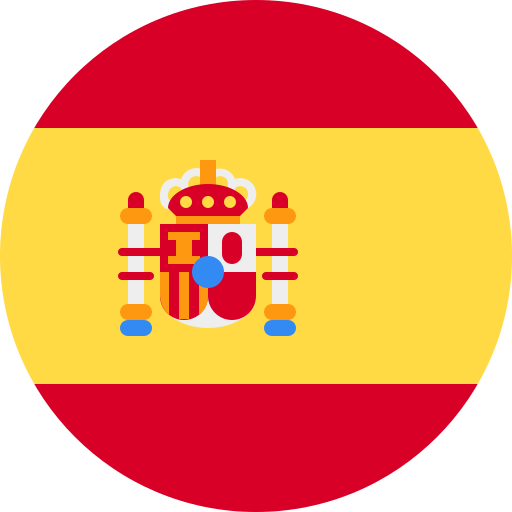

# WhatsDemo

  

**Build and share an interactive WhatsApp journey before building the integration.** Compose the conversation, try it manually or play it automatically in the phone preview, then share a link people can open and explore. WhatsDemo runs in the browser, without a backend or WhatsApp account.

  
  
  
  
  

[Open WhatsDemo](https://guilher-me.github.io/whats-demo/) · [Watch a walkthrough](docs/media/README.md#luma-home-walkthrough) · [Changelog](CHANGELOG.md)

## What you can demo

| Demo                                                                                                                                      | Idioma                                                                    | What the customer can try                                                  |
| ----------------------------------------------------------------------------------------------------------------------------------------- | ------------------------------------------------------------------------- | -------------------------------------------------------------------------- |
|  [Magazine Luzia][magazine-luzia] · Retail checkout |  Português | Browse products, send a cart and see a simulated Pix charge for the order. |
|  [OdontoNext][odontonext] · Dental booking              |  Português | Complete a WhatsApp Flow and receive a personalized confirmation.          |
|  [CatLove][catlove] · Pet delivery                         |  Português | Reply to a delivery update template and send a simulated voice note.       |
|  [iReplace][ireplace] · Repair intake                     |  English   | Choose a problem, send a simulated photo and get a location card.          |
|  [NoBank][nobank] · Banking self-service                    |  Español   | Choose a statement period and open a simulated PDF.                        |

Use the visual editor or journey JSON to build a scenario. Save it in your browser, share it as a link, or export a phone-only video or GIF. Use fictional data in shared journeys.

## Documentation

- [Get started](docs/getting-started.md) for local setup and the portable HTML build.
- [User guide](docs/user-guide.md) for editing, playback, sharing and recording.
- [Build with an LLM](docs/ai-guide.md) and [Automation API](docs/automation.md) for the journey schema, validation and link generation.
- [Architecture](docs/architecture.md) and [Deployment](docs/deployment.md) for project internals and the GitHub Pages workflow.
- [Contributing](CONTRIBUTING.md) · [Report an issue](https://github.com/guilher-me/whats-demo/issues) · [MIT license](LICENSE)

WhatsDemo is an independent simulator for fictional conversations.

[magazine-luzia]: https://guilher-me.github.io/whats-demo/#demo=v3z.SbEtx1Nf1mNJbaI36AYcCjduQLi4ZvPrg4reHJWKVT5lhTXp51tUneBkmbYf4LQRNrFcQjnGcEUCOgRK9zfsQd3iIodBbfY1KdIvBV75S9KZlrcNXJ7K3xzM6axmAhlMwRrge8KVoDtZbagLhTcVsE0Nv1is5qFXVC8FvSjxahdubXCWm1AbqS6flCEdVkiA0Q9i8nUc8EhCTZjCYsedT0RcKctTZXRRsLELcp7LZ8ZJHKYHDBo5yGDTbJktWVZL2psjUy0te036HXHXrJjw0VTS3mkd2QH2SYdbmxzjbtJLtca5FW7mMIhcOmvQQMQNaxpCtKNO6hvan8egSmEybpChkY98jtrC0ynRr8Btf62NXg1LukE9XLniCBKUOzJ5ySeZJsydOdjiXtNsSoPC5bW4W9WlOgKx2SLPz9oCUfS7to58R8lyBqqaDSQjFz8seuaGaM2wpuZ60WOaoi3S27XV9ZQ4iJwoNe2TlBbrCZ84teRGz9KAbbTJ7axWWcr5lU6mcYeRRo8t2NMbq05BHGhBkeuNS9zNjDg6GkwATjuOuEYOFinbcOAcU2CzdJn2xXNcf5iR5MYKbGGrOgZoyhm9nVNPAAR8S0lK0SBv9mCzKciImMM7o3GEyzAKyAHVKIu3CbBGriU6pVZyJHv80b5Aaelmf0v7Lu1cX659pb012I7BI3wgZWnzbgNn0KkpwnxY2OdgJJ9AVe8QGouGPQe8Oj4QWltr6jXz3XmK7pySW0AWZ7C1LSTxorUN1lVWlnIPfId87lAwEz2inrnm0dlKXU45EFjvrgAtEzpSYphMsAkPsOPD9KzUJR6I4wqnLSpsQSh6x8oycpT8OF65E2fGVhyc0E&lang=pt-BR
[odontonext]: https://guilher-me.github.io/whats-demo/#demo=v3z.SbFLY8AfdCrECmo1756vHaWjY1LJAp3wveKKo0tsPK8NPboqSskCyLiKuBwIiEdYeY4J5cKKiVd57Ppp5INqHXP48lLLkjFoXpGEPXEXN9yQN3Ity0PX4Umt4FwRRzNaYMierfRvBFEATBkxyXeUbjedvFIjHwOoePGWeXlZXAZwv6KT4rveHU4WIT4wHH5WNA3pxjBq8CO8pvLuMeCGPtzUarE0wRnE8HxNBBAYghiwRZgO9Uv4jKclJ6jU25a02qEcOSF44caLUxZal3hUdZVWUQzFhZ0pG5bpP2xK24T6ONQUQngDRylbaSp6TvIp7X52fMvdNzCe8Fuqt0SDRyahlnhECx586oY0VXWrHdtmEYkUAagjNweSH2zTxgRzs8ZxDGpRrBQEGKFO43FdBOMI8Rv4x0tYadWXgfQ79JP0AvQkhRkwiIHvYmDRvr8BwU3mQKHZJS7tX71sUrFVV3zeodBAe5uIIud6eEn5dDeokbzZwwJEP5veKMe7ZuwKO0v6Q3jVExuNjf5KG1iWgA0Pt2cBKJRItTqvlehFOZRsvH3dg9cUmJVgM4EfBmnHrVdRt60VKZ4KQ4P4J218BzqEvKk27fRnRLcAIihInFe3gY1Ab8ors6BrWclvQqw2YzINvYp8uWJLN1dMKJY6Bfa6c6aPqzlPsf2NpWAFuU2MNOQUNd33zpSZipWgcyNe3m8OTchWiob9bxLDElKb4PzLkYH0KjewVxxI3Q3iBMvV4YH8QOhOlGtOwx5rDgBMTcTpDBgzFyc9bfXFppc3tEkZnGLmdlBHwF1KZEdJvxZHcVPvLdVFHpl9NFdcpG1Z4ya2FcMlshNTEELMyXjyJFCCe6l357v1NMIpV9NYlj7ktFikI9IpizLVemzcSVoVkfbQmgql7sacRBujBF7oipBrPTBpnEXrYXUlArDKDP7bh6YMM9lb3f87HvqmmJCWFlDWXBabaTjye0lA0OuFC03weN9rykcTZVRcLcjn074DCZBKqGzTVPkuM7Vv6g4585XbJfKp5mOW6JGytxSfMB7V4PO67SXDEurVBdOsMjwTHA73F7&lang=pt-BR
[catlove]: https://guilher-me.github.io/whats-demo/#demo=v3z.SbEuAHjNvV9RqWleEnraKBZQSistYNfFPBv6SSfuXhZNJOSVhT5QwIO8uREkgmPtkwXXxoOC8aKzVmCkERwnKVnH50vx2i96tgywZDRgbIJ1J22bTqhNfUWoJYdJ8PVSmHWom4YawfE4olR4YIKoss80PfXokPiNro5wE7eqeYuHvMdj7LE4B6ySCGJWfJMXdpLZNrOjX4gvcpFt866e3G9GM4O83P63frDajDYBFU9FWvmEmELplP2FQTAiFVXkroe7nWDOkurOHURQCY0Iq7hpcfCCSNXi6PLwtDA2wfkRel42hkmMecSMsArSDpIdbltFlRom47lNW9UupApliVMtoj0RUCfsBo2zXYuMsmWqITEPWIa5vfzYqbLmVULkPfGyfCLGYzcWjkrxHLzMrouFLDLVBMl4qPDKFaEtGBw67MvWcnG5xA8xOV4jClsQmdqk1mjrLgzUfHiOwIjHdyQjmSTilzExJsbxbqQ69DxgLAsjVLgilej2S97C5XqsD9DR3JIrF3KIpMs6KgJywmgyxZEuZSuwRT0Hp1ISiqMQaXADexFemP7b5u07Lu5xBSu2i8E07suCBDUZEYK31qAg73Lwp3o4yUeXjl8M0KFlUWb7ZJidgG32SVAtkES55N6oj3bb&lang=pt-BR
[ireplace]: https://guilher-me.github.io/whats-demo/#demo=v3z.SbEuAiEbnQ9NP9rSQ7leYGpttPhuuq6KaWBjrUD0ljNEKJDcoBiWwvZNUiTJIjxtuAnJDIwoFqg6t1d4IAvNXCHKpAdwGnJJurfr1GNKBR4uJKFhMTZfFomkWpM6Rsy2DkXPy3LLrHrxBkVACNYcqEcCYwNq0C2eJRBm3AmYIad1mMBc3Y0d6aMybHi9YzdXyQnPrn3auyGm3gh3lUSBDFSlSNBx7yl7cNQkLBO2leAybssEBGtDv3p3hzkllybU5GgrnhYmuAR3xmOTdqqMLvOK1aruX7kqS5F0UbcGi2R1VnCAGid7SKp9pz4KK13UUL57s5bKT4Ww8YQCoOeylunUIFJSR0xaWfnYCDUA5aPJZEtpHwNQKa471nPQUgwejfddCo509IX2BjnmoJprgRxY8fDtnVJWLkG8anQuvrxbqUiBB64WhfA3yfal8jq7gFARs6sc1psDJjGaQnyhJGAr6U5toBVxRy9NGWNoEX8cxrHlzY529Uy0vBATI0NpvDKlpYFdsWMgt7jBJ40g2BsYpyVVJw5pUK9q7ua5XFNawTdrlkT711MJhjdcflqiGxVFqMcScxC65bUKb3R7H0NqVnG0jseybf2GRv8nhF5Es5mOtmYyl1uN5A2660kD3gdzks9tshoar1tWJQdptwUCm3iMYgcNoBWTRtpFIIqC0eoFc2bmIHbyjEriMjs4P2rlDw5NFZNeNWo1fpyClUWOzy13WrzdHZEeW1p3PdRwOXvB08cjWIYtVqAbJBPzPyjgPtWkPN4FWSygUpoqrh09PVNTPkVwCtV0x66EkEtPbr5YI2d6un6AhFITGYh1PsQJcypMnCmdbiSFeQYz2bfkS2&lang=en
[nobank]: https://guilher-me.github.io/whats-demo/#demo=v3z.SbEuAH1TJdRuidFYTadYdTZT3XMqAxphSc9D1UTOa7Utxn8t8kmmDPxqGT7uvqhAXu1DFRRXqGpqc2fvpQx3INLHdP6R8Zo8CNpbUz0CnnvdybIrPA7SnztUCbJpEcJr3kbettKbkvlA1sdVaTp2tEd7gjHIERKQbUEd4gqAIebyWTwqCUzjqUbvRjmZogiG7MwCvtePwcNj9UVtmR2RVVTFBi1i3eAcd5xVInS4tdMOnXTjswekWNl3PWgtCW9psGmc6C17xRz5FBTVWHElzsfM66cVyCumCoOtj5Cvynvvif0RS8w9PXwntfT0ok2Clecywq0jeCuMKunRoL4NF1XrgDSr6nxFu24UsZMP0cBOHxlFVAhC3ZO7VSjC2jFaiEjFf5rvrdx7Jw5baDKyoT3viVJISVWz3ahay88D2Y6Db9hC03fXxm4VR2gZPYTLt7JrEtkHzzeotIjfWHrVEytn36ohJN7aZVOlwkJEbuhiBXYOcvZwPQPshwBVeRO2DF2mJMye1biddTfu278gxB1yiaIcAbZn15716IvcwrYEr9sENjh8iHNpLRG8pTOUjY4BzQAEjCsnoSQ2HkZrAdRT5b1lmF8EbR6SYVTHoSYMTcvpAkKZdUm8OzR&lang=es
