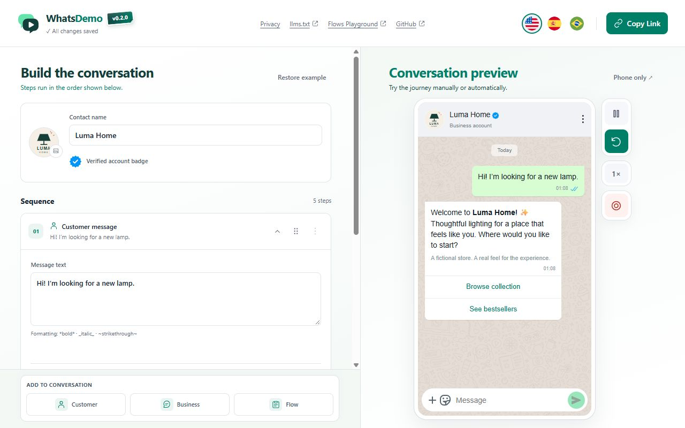

# Documentation media

## Luma Home walkthrough

In this recorded example, a customer explores a fictional lighting store, chooses a lamp and completes a two-screen Flow.

https://github.com/user-attachments/assets/4c12369b-d540-4811-889e-cf8848766625

The [original MP4](luma-home-demo.mp4) is also available in the repository. See [asset sources and notices](../../assets/README.md).

## Feature references

The Christmas snowfall PR uses [before](christmas-snow-off.jpg) and [after](christmas-snow-on.jpg) screenshots. To reproduce them, open the editor in dark mode at 1200 × 860, play a one-message greeting for the fictional Pine Studio contact, then turn on **Christmas snow** from the header.

The journey library PR uses [before](journey-library-before.jpg) and [after](journey-library-after.jpg) screenshots. To reproduce the after view, use the editor at 1280 × 860, create two one-message journeys for the fictional Pine Studio contact, name them **Pickup confirmation** and **Customer welcome**, then open **My journeys**.

The business icon picker PR uses [before](business-icon-picker-before.jpg) and [after](business-icon-picker-after.jpg) screenshots. To reproduce them, open the editor at 1280 × 860 with a one-message journey for the fictional Pine Studio contact. Open **Business icon** in the previous editor or select the pencil on the avatar in the new editor.
